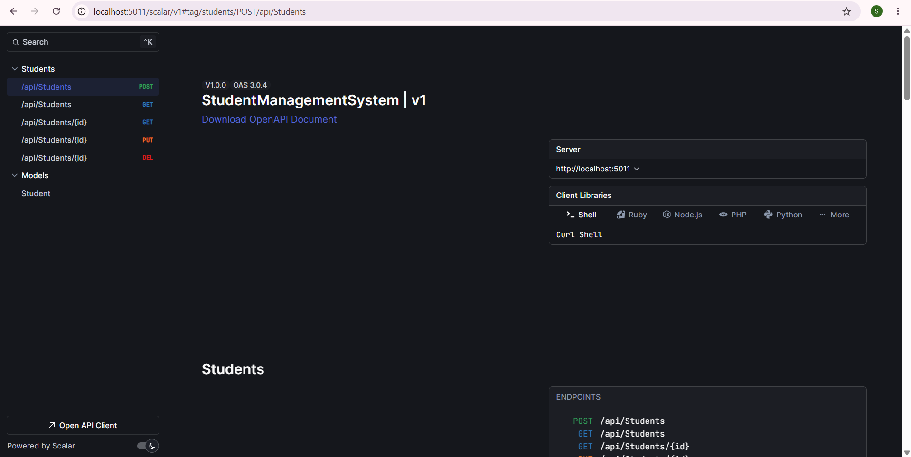
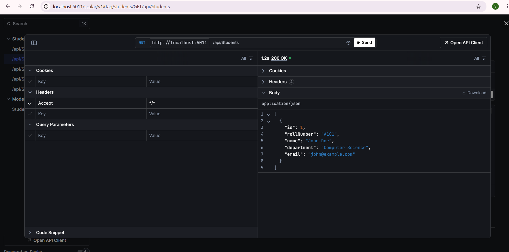

# Student Management System - Full Backend API

A complete backend software system built using an ASP.NET Core Web API. This system manages student data tracks and integrates persistent local storage using Entity Framework Core and Microsoft SQL Server.

---

## 🏗️ System Architecture Workflow

Below is the execution diagram showing how a web request moves from your browser down into your physical database storage tracks:

```text
[ Web Browser / Scalar UI ] 
       │
       │ (1) Sends HTTP Request (JSON Data Object)
       ▼
[ ASP.NET Core Routing Pipeline ]
       │
       │ (2) Matches URL Pattern Paths
       ▼
[ StudentsController.cs ]
       │
       │ (3) Evaluates CRUD Method Actions (GET/POST)
       ▼
[ AppDbContext.cs (EF Core ORM) ]
       │
       │ (4) Translates C# Logic into Structured SQL Script Query
       ▼
[ Microsoft SQL Server Database ]
       │
       │ (5) Writes / Reads Live Row Records Permanently
       ▼
[ Persistent Storage (Student Tables) ]
```

---

## 🛠️ Step-by-Step System Installation Guide

Follow these sequential environment setup execution steps to build and boot the application from scratch:

### 1. Download Core Project Package Libraries
Execute these commands inside the root directory terminal to fetch required database connector engines:
```powershell
dotnet add package Microsoft.EntityFrameworkCore.SqlServer --version 9.0.0
dotnet add package Microsoft.EntityFrameworkCore.Tools --version 9.0.0
dotnet add package Scalar.AspNetCore --version 2.0.14
```

### 2. Generate the Database Structure Blueprints
Build the physical table layout blueprint map tracks using Code-First migration generators:
```powershell
dotnet ef migrations add InitialCreate
dotnet ef database update
```

### 3. Launch the Active Server Context Instance
Spin up the local network listener instance engine:
```powershell
dotnet run
```
*The server will initialize active background listening loops at:* `http://localhost:5011`

---

## 💻 Tech Stack Portfolio Summary
* **Programming Language:** C#
* **Framework Infrastructure:** ASP.NET Core Web API (.NET 9)
* **Object-Relational Mapper (ORM):** Entity Framework Core
* **Database Management Engine:** Microsoft SQL Server
* **Interactive Testing Panel Interface:** Scalar UI / OpenAPI Specifications

---

## 📂 Project Structure Map Guide
* **`/Models/Student.cs`** -> Contains the standard structural fields defining a student entry entity profile layout.
* **`/Data/AppDbContext.cs`** -> Acts as the data translator bridge handling active secure query sessions with the server.
* **`/Controllers/StudentsController.cs`** -> Manages network request routing logic policies for full CRUD execution paths.
* **`Program.cs`** -> Configures application startup pipeline sequences and registers server context injection channels.

---

## 📊 Live Verification & Output Screenshots

### 1. Adding a Student Record (POST Request Success)
Verification of an HTTP POST network packet successfully updating database tables and generating a primary tracking index key (`"id": 1`), returning a `200 OK` status badge:



### 2. Retrieving Live Records (GET Request Success)
Verification of reading persistent text records back out of the physical storage layer array slots:


